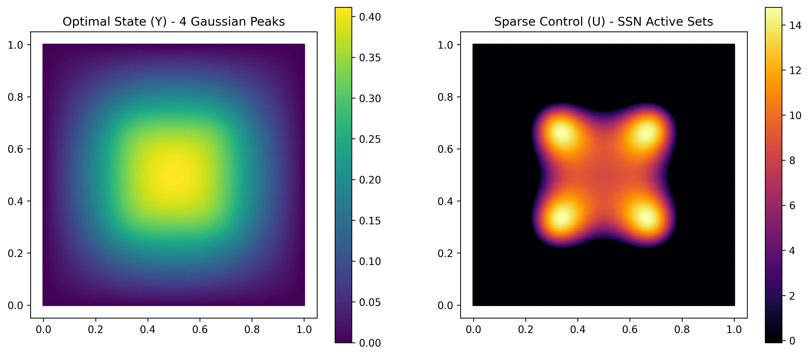

# FEniCSx-SSN

A compact research-code release for semismooth Newton / primal-dual active-set methods in sparse PDE-constrained optimal control.

The core implementation is built on FEniCSx/dolfinx and supports 2D and 3D problems, direct or AMG-backed linear solves, adaptive mesh refinement, result export, and an experimental SSN-guided XPINN stage.

## Scope

This release contains the reusable solver and validation code only. Internal research notes, literature archives, unpublished novelty analysis, generated datasets, experiment logs, and development-agent files are intentionally excluded.

## Repository layout

- `ssn/` — semismooth Newton / PDAS solver, AMR, AMG, export and active-set extraction
- `xpinn/` — experimental SSN-guided XPINN components
- `interface/` — SSN result data contract
- `tests/` — numerical and regression tests
- `figures/showcase/` — selected solver outputs
- `run_ssn.py` — primary solver entry point
- `run_xpinn.py` — XPINN training/evaluation entry point
- `run_pipeline.py` — SSN → XPINN pipeline
- `Dockerfile` — FEniCSx 0.7.3 + PyTorch CPU environment

## Quick start

Build the container:

```bash
docker build -t fenicsx-ssn .
```

Run a 2D problem:

```bash
docker run --rm -v "$PWD":/workspace -w /workspace fenicsx-ssn \
  python3 run_ssn.py --mesh 64 --output ssn_result.npz
```

Run a 3D problem with AMG:

```bash
docker run --rm -v "$PWD":/workspace -w /workspace fenicsx-ssn \
  python3 run_ssn.py --dim 3 --mesh 24 --solver amg --output ssn_result.npz
```

Run the experimental SSN-guided XPINN stage:

```bash
docker run --rm -v "$PWD":/workspace -w /workspace fenicsx-ssn \
  python3 run_xpinn.py --input ssn_result.npz
```

Or run the combined pipeline:

```bash
docker run --rm -v "$PWD":/workspace -w /workspace fenicsx-ssn \
  python3 run_pipeline.py
```

## Method

The solver targets sparse optimal-control problems with an L1 term and a small L2/Tikhonov regularization. The active set is evaluated from the adjoint state and the nonsmooth control relation is handled explicitly within a PDAS / semismooth Newton iteration rather than delegated to generic automatic differentiation.

The repository also includes optional AMR and AMG components and an experimental interface-conditioned XPINN workflow. The XPINN code should be treated as research code rather than a general-purpose neural PDE solver.

## Validation

The `tests/` directory includes smoke tests, active-set checks, damping cases, mesh-independence checks, AMR/AMG cases, strict-complementarity cases, and several deliberately difficult or failure-oriented scenarios.

A representative solver output is shown below.



## Reproducibility notes

The reference environment is based on `dolfinx/dolfinx:v0.7.3`. Numerical behavior may vary with PETSc, MUMPS, HYPRE, MPI, and mesh-generation versions.

This branch is a sanitized release candidate. It intentionally does not preserve the private repository's full research history.

## License

Licensing is not finalized in this release-candidate branch. No permission to reuse or redistribute the code should be inferred beyond rights granted by applicable law and GitHub's terms.
